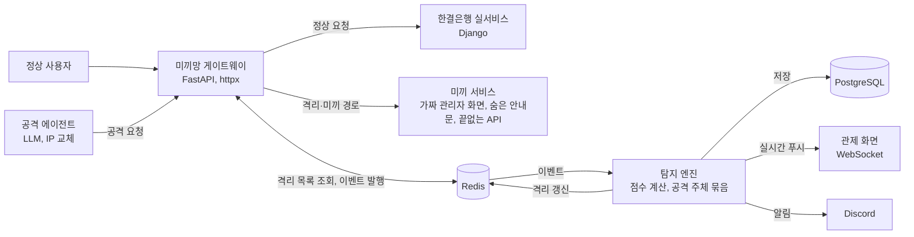

<aside>
💡

주제: **미끼망 관제실**. 상세 설계 원문과 아키텍처 다이어그램은 미끼망 관제실 설계안에 있습니다. 타깃 고객, 비즈니스 모델, 향후 계획은 초안이니 팀에서 확인해 주세요.

</aside>

## 서비스 한 줄 소개

AI 공격 에이전트만 걸려드는 미끼를 깔아 두고, IP를 바꿔도 같은 공격자로 묶어 가짜 데이터 공간에 가두는 보안 게이트웨이입니다.

## 문제 정의

- 2026년 9월 말부터 신한은행(고객 25,729명), KB국민은행, 하나은행, 웰컴저축은행, 대신증권(38,490명) 등에서 연쇄 유출이 이어졌습니다.
- 금융당국은 공격자가 IP를 바꿔 가며 AI 도구로 여러 금융회사를 대량·자동으로 공격했을 가능성을 언급했습니다.
- 지금의 IP 차단 중심 방어는 IP를 계속 바꾸는 AI 에이전트를 같은 공격자로 알아보지 못합니다. 차단하면 공격자는 곧바로 새 IP로 돌아옵니다.

## 타깃 고객

- 핵심 고객: 은행, 저축은행, 증권사, 온라인투자연계금융업체의 보안팀 (초안)
- 고객이 지금 쓰는 대안: 웹 방화벽의 IP 차단과 속도 제한, 사람 공격자를 겨냥한 허니팟

## 해결 방법

AI 에이전트는 화면과 문서의 글을 읽고 다음 행동을 정합니다. 공격자가 프롬프트 인젝션으로 에이전트를 조종하듯, 방어자도 에이전트만 읽는 글로 에이전트를 함정으로 유도합니다.

- **미끼 4종**: robots.txt 속 가짜 관리자 경로, 링크 없는 숨김 관리자 화면, API 문서 속 숨은 안내문, 추적 표식이 든 가짜 데이터를 끝없이 주는 내보내기 API
- **즉시 격리**: 정상 사용자는 닿을 일이 없는 미끼 경로에 접근하면 바로 공격 주체로 등록합니다.
- **차단 대신 가두기**: 격리된 공격자는 실서비스 대신 미끼 서비스로 보냅니다. 공격자는 계속 성공한다고 믿고 시간을 쓰고, 그동안 행동 지문과 IP를 모읍니다.
- **IP가 바뀌어도 묶기**: 미끼 응답에 넣은 서명 토큰의 재사용은 확정, 헤더 순서·User-Agent·경로 탐색 순서 유사도는 추정으로 같은 공격 주체에 묶습니다.
- **관제 화면**: 공격 에이전트의 요청, 함정 접촉, 묶인 IP, 실제 유출 0건을 실시간으로 보여주고 Slack에 알립니다.

## 차별점

| 구분 | 기존 대안 | 우리 서비스 |
| --- | --- | --- |
| 대응 방식 | IP 차단, 공격자는 새 IP로 재시도 | 차단하지 않고 미끼 서비스에 가둠 |
| 공격자 식별 | IP 단위로만 판단 | 서명 토큰과 행동 지문으로 IP가 바뀌어도 같은 공격 주체로 묶음 |
| 겨냥 대상 | 사람 공격자, 정해진 스캐너 | 글을 읽고 따르는 LLM 공격 에이전트 |
| 유출 시 추적 | 어떤 데이터가 나갔는지 사후 조사 | 가짜 레코드에 공격 주체별 표식이 있어 출처 추적 가능 |

## 비즈니스 모델

초안입니다.

- 누가 돈을 내나요? 금융회사와 핀테크의 보안팀
- 어떻게 돈을 버나요? 보호 도메인 수와 트래픽 기준의 구독형 SaaS, 기존 웹 방화벽 앞단에 붙이는 설치형 라이선스
- 초기 고객은 어떻게 모을 건가요? 이번 연쇄 유출을 겪은 2금융권과 온투업체 대상 무료 파일럿

## 시장 규모와 근거

- 2026년 금융권 AI 해킹 및 정보유출 사태 (IT위키): 신한은행 25,729명 등 은행권 연쇄 유출, 공격 인프라에서 자율 침투 도구 흔적 확인
- 웰컴저축은행 사고 (IT위키): 동일 공격자 추정 IP가 7개 금융회사에서 발견, AI 도구를 이용한 대량·자동화 공격 가능성
- 대신증권 해킹사고 (스마트투데이): 38,490명 정보 유출
- 시장 규모 수치는 아직 비어 있습니다. 국내 금융권 정보보호 예산 통계를 찾아 채워 주세요.

## 향후 계획

초안입니다.

1. PoC: 가상 은행 한결은행에 미끼망을 붙이고, 실제 LLM 에이전트 공격을 막는 장면 시연
2. MVP: 상용 웹 방화벽과 연동, 행동 지문 모델 고도화, 오탐 관리 화면
3. 파일럿: 금융회사 1~2곳의 테스트 환경에 설치해 실제 자동화 공격 데이터 수집
4. 정식 출시: 미끼 템플릿 마켓, 금융권 공동 공격자 지문 공유

## 시스템 구성

데이터 모델, 이벤트 형식, 관제 API, 점수 규칙, 역할 분담, 시간 계획은 미끼망 관제실 설계안을 참고해 주세요.
